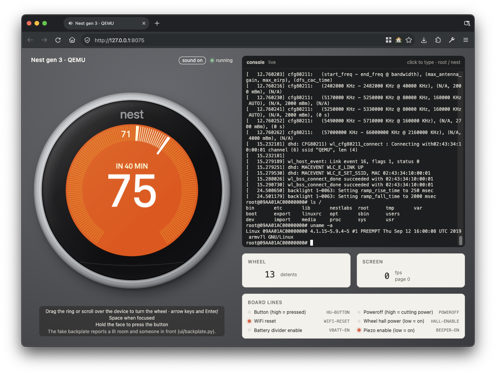

# unfr0zen qemu

QEMU machines that boot the stock firmware of Nest Learning Thermostats from their NAND image.



## Support

| Machine | Unit | SoC | Firmware |
| --- | --- | --- | --- |
| `-M flintstone` | gen 3 (Display-3.4) | i.MX6SoloX | U-Boot 2014.04, Linux 4.1.15, UBIFS root |
| `-M j49` | gen 2 (Display-2.x) | TI AM3703 | x-loader, U-Boot 2012.10, Linux 2.6.37, JFFS2 root |

- Modelled: display, ring, button, piezo, backplate, WiFi, Thread radio.
- Gen 3 USB: automatic host attachment on supported Linux hosts;
  [USB/IP export](docs/usb-host-bridge-protocol.md) on macOS.
- Not modelled: gen 2 USB device mode, ENET, other Thread nodes.
- Hosts: Linux, macOS (Apple silicon and Intel).

## Setup

### Docker build (default)

| Tool | macOS | Debian/Ubuntu |
| --- | --- | --- |
| Docker | Docker Desktop, OrbStack or Colima | `docker.io` or Docker Engine, user in the `docker` group |
| git | `xcode-select --install` or `brew install git` | `apt install git` |
| python3 | `xcode-select --install` or `brew install python` | `apt install python3` |
| shasum | built in | `apt install perl` |

```sh
./setup.sh docker    # clones QEMU v11.0.0 into qemu-src/, applies patches/, builds (~15 min)
```

### Native build

```sh
# macOS
brew install meson ninja pkg-config glib pixman libslirp
# Debian/Ubuntu
sudo apt install git build-essential flex bison pkg-config libglib2.0-dev \
    libpixman-1-dev zlib1g-dev libslirp-dev python3 pipx
pipx install 'meson>=1.5' && pipx install ninja
```

```sh
./setup.sh
```

- Re-run `./setup.sh` to rebuild after editing `qemu-src/`.
- Patches apply only to a fresh clone: after pulling new patches,
  `rm -rf qemu-src && ./setup.sh`.

## Run

You supply the NAND image; formats in [docs/nand-image.md](docs/nand-image.md).
`--nand` seeds a working copy in `.qemu/`; the source image is never written.

```sh
# gen 3: 512 MiB logical image (data pages only)
./run.sh --nand nand-logical.bin   # first boot
./run.sh                           # later boots
./run.sh --ui                      # + web page at http://127.0.0.1:8075
./run.sh --no-usb                  # opt out of automatic Linux USB attachment

# gen 2: raw chip, data + OOB pages
./run.sh --gen2 --nand nand-j49.raw
./run.sh --gen2 --ui
```

| Option | Effect |
| --- | --- |
| `--ui` | web page with display, ring, button and console |
| `--ssh PORT` | guest sshd on `127.0.0.1:PORT` |
| `--cloud` | internet access (default: DHCP only) |
| `--mqtt HOST[:PORT]` | guest reaches a broker at `10.0.2.100:1883` |
| `--no-provision` | boot the NAND unmodified |
| `--sleep` | keep the stock 20 s screen timeout |
| `--hostname NAME` | NAME in the console prompt instead of the serial number (gen 3) |
| `--nlclient FILE` | isolated NAND, install FILE as nlclient after boot |
| `--root0` / `--root1` | select the boot slot |
| `NAND_FRESH=1` | re-seed `.qemu/` from `--nand FILE` |

- Login: `root` / `nest` (set up by the pre-boot provisioning).
- Quit: Ctrl-A X, or Ctrl-] with `--ui`.
- Full option list: header of `run.sh` and [docs/qemu.md](docs/qemu.md#runsh-options).

### MCP server

`ui/mcp_server.py` (stdio, standard library only) gives an agent the newest
`./run.sh --ui` unit: screenshots, recordings, button, ring, console, files,
clock, backplate and QMP. Tool list:
[docs/qemu.md](docs/qemu.md#driving-it-from-an-agent-mcp).

```sh
./run.sh --ui --ssh 2222   # --ssh: files over ssh (~3 MB/s) instead of the console (~60 KB/s)
```

Claude Code in this repo: nothing to do, `.mcp.json` declares it as `nest`.
Elsewhere:

```sh
claude mcp add --scope user nest -- python3 /path/to/qemu/ui/mcp_server.py
```

Claude Desktop, Cursor and other JSON-configured clients:

```json
{
  "mcpServers": {
    "nest": {
      "command": "python3",
      "args": ["/path/to/qemu/ui/mcp_server.py"]
    }
  }
}
```

Codex (`~/.codex/config.toml`):

```toml
[mcp_servers.nest]
command = "python3"
args = ["/path/to/qemu/ui/mcp_server.py"]
```

- Check: ask the agent to call `status`.
- Pin a unit: `--url http://127.0.0.1:PORT` in `args`, or `NEST_UI_URL`.
- Recordings need `ffmpeg` on `PATH` (PNG frames without it).

## Disclaimer

This project is not affiliated with, endorsed by, or sponsored by Google LLC
or Nest Labs. "Nest" and "Nest Learning Thermostat" are trademarks of Google
LLC.

No firmware, NAND images or other Google/Nest software are included in or
distributed through this repository, and none will be provided on request.
Use only images dumped from devices you own.

## License

GPL-2.0, see [LICENSE](LICENSE). The wordmark font is
[Inter](https://github.com/rsms/inter), under the SIL Open Font License
(`ui/fonts/OFL-Inter.txt`).
