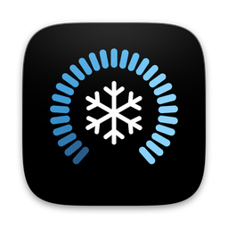
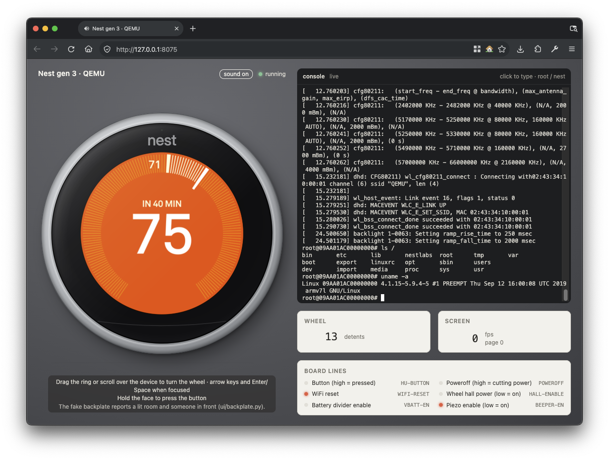
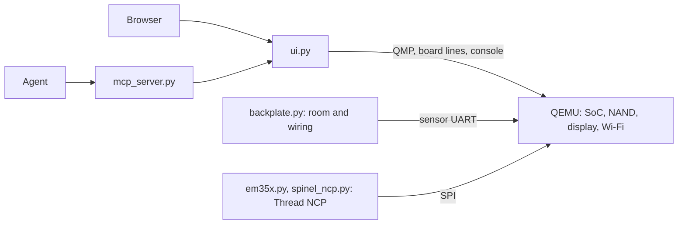

<div align="center">



# unfr0zen qemu

**A Nest Learning Thermostat on your desktop: its own stock firmware, booted from its own NAND, screen, ring and all.**

[](https://dl.circleci.com/status-badge/redirect/gh/unfr0zen/qemu/tree/main)
[](https://www.qemu.org/)
[](#setup)
[](LICENSE)
[](https://discord.gg/fBqjAFARYg)
[](https://buymeacoffee.com/willtm)

</div>

QEMU machines that boot the stock firmware of Nest Learning Thermostats from a dump of their NAND: boot ROM, U-Boot,
Linux and the thermostat's own UI, unchanged. Turn the ring, press the glass, heat a simulated room, join Wi-Fi, flash a
system update, or hand the whole unit to an agent, without a thermostat on the bench. It is the test bench for
[unfr0zen](https://github.com/unfr0zen/unfr0zen).

<p align="center">
  
</p>

## Features

- **Real firmware, real boot.** The boot ROM stub reads U-Boot out of the NAND like the silicon does; nothing is
  loaded from outside the image and nothing in the firmware knows it is emulated.
- **The unit in your browser** (`--ui`): every frame the screen shows, the ring by drag, scroll or arrow keys, the
  glass by click, the piezo's clicks and tones, and the serial console.
- **A room that answers back.** A simulated backplate reports wiring, temperature, humidity, light and motion; the
  room warms while the unit heats and cools while it cools, and backplate firmware updates flash and stick.
- **Wi-Fi with neighbours.** The stock driver and chip firmware join a fake access point, a scan finds more to test
  the UI against, the unit stays offline unless you pass `--cloud`, and `--mqtt` points it at a broker.
- **Thread radio.** The radio's network co-processor boots, scans and forms a Thread network of its own.
- **GPU.** A Vivante GC400T for the stock galcore stack, drawn in software or on the host GPU.
- **Agent-ready.** An MCP server gives Claude Code, Codex, Cursor and friends screenshots, recordings, inputs, the
  console, files, the clock, the backplate, QMP and gdb.
- **Live files, firmware untouched.** `--fs ro` / `--fs rw` read and atomically replace files through QEMU's debugger
  and the guest's own kernel, with no login, network or helper in the guest.
- **USB.** The diamond3's USB device attaches to a Linux host, or is exported over USB/IP on macOS.
- **Linux and macOS**, Apple silicon and Intel, built in Docker or natively.

## Machines

| Nest | Machine | SoC | Status |
| --- | --- | --- | --- |
| Thermostat E (Display-4.x) | [`-M onyx`](docs/qemu-onyx.md) | i.MX6UL | full boot |
| 3rd gen (Display-3.4) | [`-M diamond3`](docs/qemu.md) | i.MX6SoloX | full boot |
| 2nd gen (Display-2.x) | [`-M j49`](docs/qemu-j49.md) | TI AM3703 | full boot |
| 1st gen (Diamond-1.9/1.10) | [`-M diamond`](docs/qemu-diamond.md) | TI AM3703 | full boot |

- **Modelled:** display, ring, button, piezo, backplate, Wi-Fi, Thread radio.
- **USB to the host:** diamond3 only, attached automatically on supported Linux hosts and
  [exported over USB/IP](docs/usb-host-bridge-protocol.md) on macOS. The j49 and onyx model their USB device controllers
  behind a virtual-host socket; the diamond has none.
- **Not modelled:** ENET, other Thread nodes. Full lists in each machine's doc.

## Quick start

```sh
./setup.sh docker                  # build QEMU with the machines (~15 min, once)
./run.sh --nand nand-logical.bin   # first boot of your diamond3 image
./run.sh --ui                      # then: open http://127.0.0.1:8075
```

Log in as `root` / `nest`. Quit with Ctrl-A X, or Ctrl-] with `--ui`.

## Setup

### Docker build (default)

| Tool | macOS | Debian/Ubuntu |
| --- | --- | --- |
| Docker | Docker Desktop, OrbStack or Colima | `docker.io` or Docker Engine, user in the `docker` group |
| git | `xcode-select --install` or `brew install git` | `apt install git` |
| python3 | `xcode-select --install` or `brew install python` | `apt install python3` |
| shasum | built in | `apt install perl` |

```sh
./setup.sh docker    # clones QEMU v11.0.0 into qemu-src/, applies patches/, builds (~15 min)
```

### Native build

```sh
# macOS
brew install meson ninja pkg-config glib pixman libslirp
# Debian/Ubuntu
sudo apt install git build-essential flex bison pkg-config libglib2.0-dev \
    libpixman-1-dev zlib1g-dev libslirp-dev python3 pipx
# Optional Linux host GPU backend
sudo apt install libepoxy-dev libegl1-mesa-dev
pipx install 'meson>=1.5' && pipx install ninja
```

```sh
./setup.sh
```

- Re-run `./setup.sh` to rebuild after editing `qemu-src/`.
- Patches apply only to a fresh clone: after pulling new patches, `rm -rf qemu-src && ./setup.sh`.

## Run

You supply the NAND image; formats in [docs/nand-image.md](docs/nand-image.md). `--nand` seeds a working copy in
`.qemu/`; the source image is never written.

```sh
# diamond3: 512 MiB logical image (data pages only)
./run.sh --nand nand-logical.bin   # first boot
./run.sh                           # later boots
./run.sh --ui                      # + web page at http://127.0.0.1:8075
./run.sh --no-usb                  # opt out of automatic Linux USB attachment

# j49: raw chip, data + OOB pages
./run.sh --j49 --nand nand-j49.raw
./run.sh --j49 --ui

# diamond: raw 256 MiB chip, data + OOB pages
./run.sh --diamond --nand diamond.raw

# onyx: firmware is embedded in the prepared NAND image
./run.sh --onyx --ui              # uses .qemu/onyx/nand-state.bin
```

Onyx's UI provides the display, ring, button, piezo, backplate, serial console, QMP, Wi-Fi (`--ssh`, `--cloud`,
`--mqtt` as on the diamond3) and a lone Thread radio (`ui/spinel_ncp.py`); USB is not modelled. Its pre-boot gives root
the password `nest`, allows root over ssh, quiets the console, keeps the screen on, saves the `QEMU` Wi-Fi network and
the backplate's wiring. `--onyx --nand FILE` seeds its working copy from a prepared Onyx NAND image; no `-bios` or
separate firmware files are required.

| Option | Effect |
| --- | --- |
| `--ui` | web page with display, ring, button and console |
| `--ssh PORT` | guest sshd on `127.0.0.1:PORT` |
| `--cloud` | internet access (default: DHCP only) |
| `--mqtt HOST[:PORT]` | guest reaches a broker at `10.0.2.100:1883` |
| `--no-provision` | boot the NAND unmodified |
| `--sleep` | keep the stock 20 s screen timeout |
| `--host-gpu` | request experimental host GPU rendering (automatic for native diamond3 on Linux/macOS; software fallback) |
| `--no-host-gpu` | force software rendering |
| `--hostname NAME` | NAME in the console prompt instead of the serial number (diamond3) |
| `--nlclient FILE` | isolated NAND, install FILE as nlclient after boot |
| `--root0` / `--root1` | select the boot slot |
| `NAND_FRESH=1` | re-seed `.qemu/` from `--nand FILE` |

- Login: `root` / `nest` (set up by the pre-boot provisioning).
- Quit: Ctrl-A X, or Ctrl-] with `--ui`.
- Full option list: header of `run.sh` and [docs/qemu.md](docs/qemu.md#runsh-options).

<details>
<summary><b>How the pieces fit together</b></summary>

QEMU models the SoC and board; small Python processes, standard library only, play the rest of the hardware over
chardevs and QMP on localhost.



The pre-boot (`scripts/provision.py`) boots the image once with `init=/bin/sh` and uses the guest's own kernel to set
root's password, keep the display on, save Wi-Fi and finish setup, so the filesystem journals stay consistent.

</details>

## Drive it from an agent

`ui/mcp_server.py` (stdio, standard library only) gives an agent the newest `./run.sh --ui` unit: screenshots,
recordings, button, ring, console, files, clock, backplate and QMP. Tool list:
[docs/qemu.md](docs/qemu.md#driving-it-from-an-agent-mcp).

```sh
./run.sh --ui --ssh 2222   # --ssh: files over ssh (~3 MB/s) instead of the console (~60 KB/s)
```

Claude Code in this repo: nothing to do, `.mcp.json` declares it as `nest`. Elsewhere:

```sh
claude mcp add --scope user nest -- python3 /path/to/qemu/ui/mcp_server.py
```

<details>
<summary><b>Claude Desktop, Cursor, Codex</b></summary>

Claude Desktop, Cursor and other JSON-configured clients:

```json
{
  "mcpServers": {
    "nest": {
      "command": "python3",
      "args": ["/path/to/qemu/ui/mcp_server.py"]
    }
  }
}
```

Codex (`~/.codex/config.toml`):

```toml
[mcp_servers.nest]
command = "python3"
args = ["/path/to/qemu/ui/mcp_server.py"]
```

</details>

- Check: ask the agent to call `status`.
- Pin a unit: `--url http://127.0.0.1:PORT` in `args`, or `NEST_UI_URL`.
- Recordings need `ffmpeg` on `PATH` (PNG frames without it).

## Documentation

| Doc | What's in it |
| --- | --- |
| [docs/qemu.md](docs/qemu.md) | the diamond3: web page, MCP, Wi-Fi and network, pre-boot, GPU, hardware model, debugging |
| [docs/qemu-j49.md](docs/qemu-j49.md) | the j49: the same, for the 2nd gen |
| [docs/qemu-diamond.md](docs/qemu-diamond.md) | the diamond: what differs from the j49 |
| [docs/qemu-onyx.md](docs/qemu-onyx.md) | the Thermostat E: NAND, boot, mask-ROM USB SDP |
| [docs/nand-image.md](docs/nand-image.md) | image formats and partition layout |
| [docs/usb-host-bridge-protocol.md](docs/usb-host-bridge-protocol.md) | the diamond3's USB on Linux and over USB/IP |

## Disclaimer

This project is not affiliated with, endorsed by, or sponsored by Google LLC or Nest Labs. "Nest" and "Nest Learning
Thermostat" are trademarks of Google LLC.

No firmware, NAND images or other Google/Nest software are included in or distributed through this repository, and none
will be provided on request. Use only images dumped from devices you own.

## License

GPL-2.0, see [LICENSE](LICENSE). The wordmark font is [Inter](https://github.com/rsms/inter), under the SIL Open Font
License (`ui/fonts/OFL-Inter.txt`).
